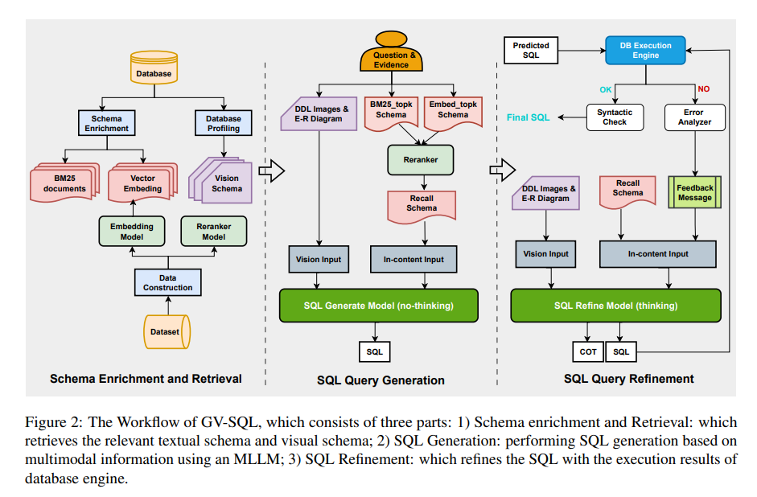

# GV-SQL: Retrieval-Enhanced Text-to-SQL Generation in Multimodal Large Language Models by Integrating Global Visual Information

we introduce GV-SQL, a novel framework that enriches the retrieval schema with integrating Global Visual information to boost SQL generation performance via multimodal large language models (MLLMs). Specifically, the database DDL schema and entity-relationship (E-R) information are rendered as global visual cues to supplement the textual input. These are then fed into a MLLM to improve both text-to-SQL generation and subsequent refinement.



# preprocessing

#### step1
Obtain the DDL schema of the database along with its statistical information <br>

```
python preprocessing/collect_ddl_schema.py
```

#### step2 
Mainly expand the description of each column via LLM to enhance its semantic expression.

```
python preprocessing/generate_enhanced_schema.py
```

#### step3
Render database DDL schema and ER relation (stored as JSON) into PNG images.

```
python preprocessing/render_schema_to_image.py
```

# workflows

#### step1
Use the original data of the dataset to build the training and evaluation data for embedding and reranker

```
python workflows/build_recall_rank_train_data.py
```

### step2
Build SQL generation training data. Use schema_retrieve_module for schema retrieval. Use query_retrieve_module to generate few-shot samples.

```
python workflows/build_sql_generation_train_data.py
```

#### step3
1) Build training data for sql refinement; <br>
2) Idea: select some models trained in the sql generation stage, predict on the training data to get predicted_sql, use the database engine to execute and analyze predict_sql, and collect some error information to build sql repair training data; <br>
3) On top of this, GV visual data can be added, and think-mode training data can also be generated accordingly (using the preprocessing.use_llm_processing_data.generate_refinement_think_output_with_vl function); <br>

```
python workflows/build_sql_refinement_train_data.py
```

# train

#### step1
train recall and ranker model

```
bash train_recall.sh / train_ranker.sh
```

#### step2
train sql generation and refinement with only textual schema

```
bash train_sql.sh/ train_sql_grpo.sh
```

#### step3
train sql generation and refinement with GV images

```
bash train_sql_vl.sh/ train_sql_vl_grpo.sh
```


