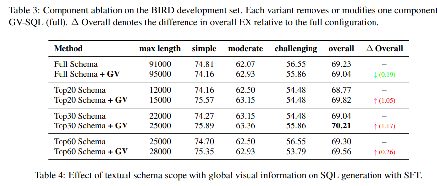
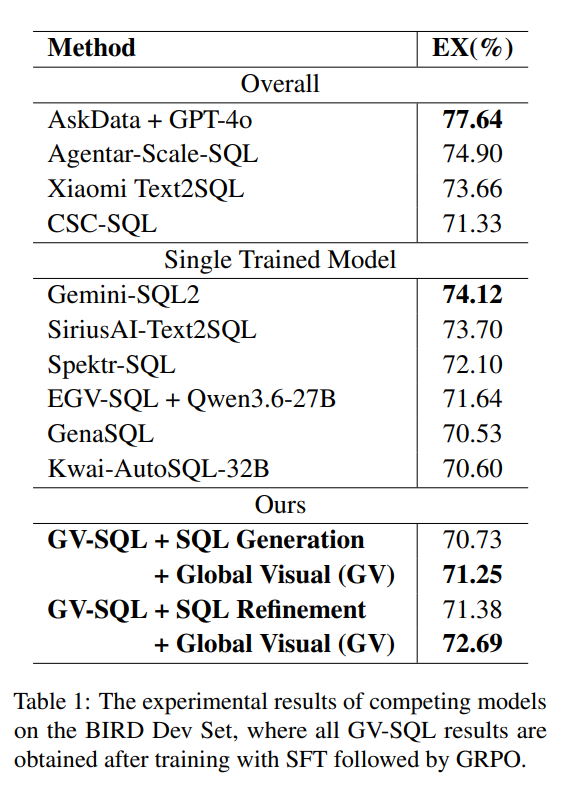

# GV-SQL: Retrieval-Enhanced Text-to-SQL Generation in Multimodal Large Language Models by Integrating Global Visual Information

we introduce GV-SQL, a novel framework that enriches the retrieval schema with integrating Global Visual information to boost SQL generation performance via multimodal large language models (MLLMs). Specifically, the database DDL schema and entity-relationship (E-R) information are rendered as global visual cues to supplement the textual input. These are then fed into a MLLM to improve both text-to-SQL generation and subsequent refinement.

